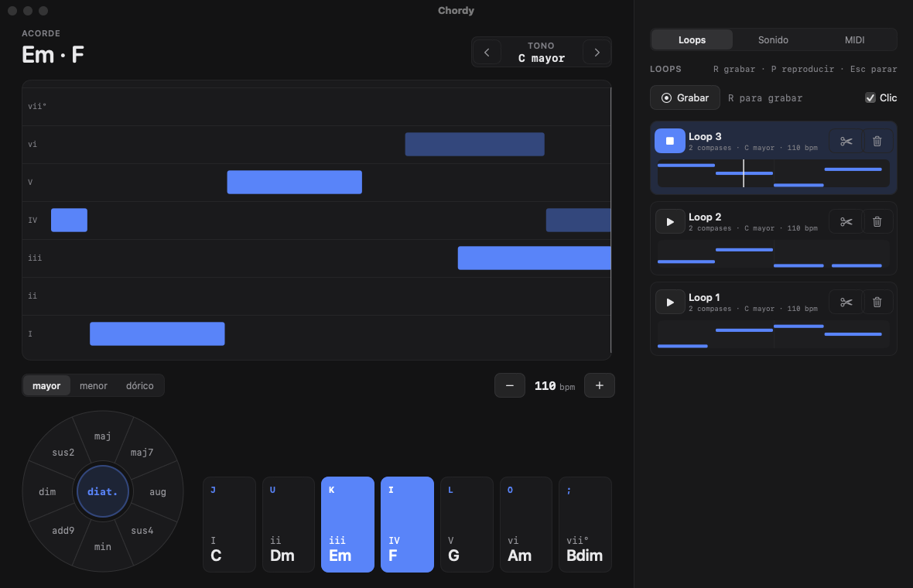
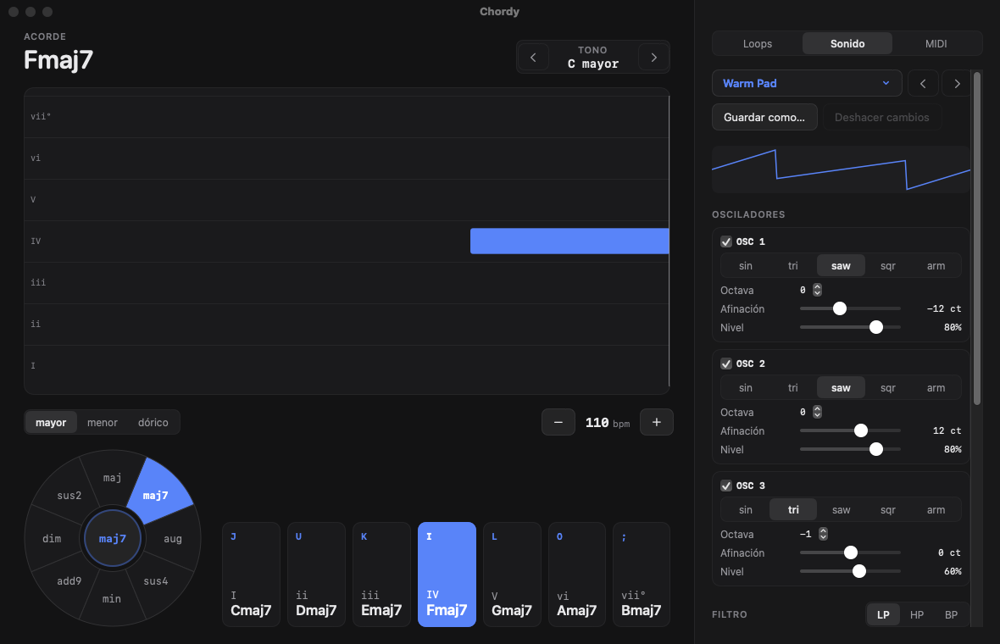
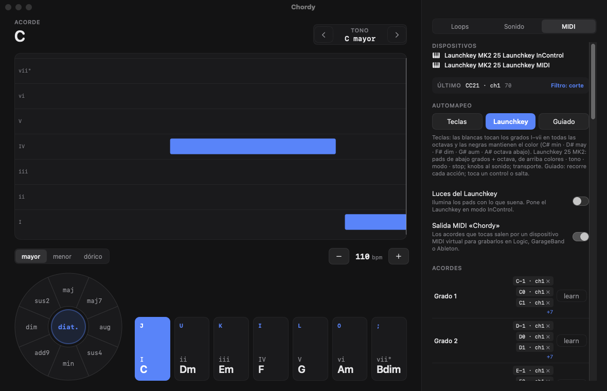

# Chordy

Toca progresiones de acordes con el teclado del Mac o tu controlador MIDI.

## Instalar

Abre Terminal y pega:

```sh
curl -fsSL https://raw.githubusercontent.com/drarekx/Chordy/main/install.sh | bash
```

El instalador descarga la última versión, la copia en `/Applications` y la abre.

Chordy se actualiza sola: busca versiones nuevas al arrancar y una vez al día (o desde el menú → **Buscar actualizaciones…**), comprueba la descarga con su SHA-256 y se reinicia ya actualizada. Se puede desactivar en Ajustes. Volver a ejecutar el comando de instalación también actualiza.

**Instalación manual:** descarga `Chordy.zip` de [Releases](https://github.com/drarekx/Chordy/releases/latest), descomprímelo y mueve `Chordy.app` a Aplicaciones. La app no está notarizada, así que la primera vez ábrela con clic derecho → **Abrir**.

Requisitos: macOS 14 (Sonoma) o posterior. Apple Silicon o Intel.

## Para qué sirve

Para tocar progresiones de acordes sin saber dónde van los dedos. Eliges el tono y el modo, y cada tecla toca un grado de la escala (I, ii, iii…) ya armonizado; con W A S D le cambias el color (mayor, menor, maj7, sus…). Con un teclado MIDI, como el Novation Launchkey, los pads, knobs y ruedas manejan todo, y lo que tocas se puede grabar en loops o mandar a tu DAW.

Basado en [ChordBoy](https://www.jameshsi.com/?ref=chordboy) de james.

## Cómo funciona

1. **Toca.** `J U K I L O ;` tocan los grados I–vii del tono elegido. Mantén `W A S D` (o arrastra en la rueda) para cambiar el color del acorde; dos a la vez dan las diagonales (maj7, sus2, sus4, add9). Mantén la **barra espaciadora** para bajar una octava. `Z`/`C` cambian el tono, `Q`/`E` el modo y `+`/`-` el tempo.

2. **Graba loops.** Pulsa `R`, toca, y `R` otra vez: el loop se cuantiza y se guarda. `P` lo reproduce en su tono y tempo, y puedes transponerlo o tocar encima mientras suena. Las tijeras abren el recorte.

<p align="center"></p>

3. **Diseña el sonido.** 14 sonidos de fábrica y un sintetizador completo: tres osciladores (con onda de armónicos dibujable), filtro con envolvente, ADSR, vibrato y volumen. Los cambios se oyen al momento y puedes guardar los tuyos.

<p align="center"></p>

4. **Conecta tu teclado MIDI.** Chordy lo detecta solo. Pulsa **Teclas** y una tecla para que las blancas toquen los grados y las negras los colores, **Launchkey** para el preset del Novation Launchkey 25 MK2 o **learn** junto a cualquier acción para asignarle el control que quieras.

<p align="center"></p>

## Todo lo que hace

- **Teclado de acordes**: tres modos (mayor, menor, dórico), los 12 tonos, nueve colores de acorde y octava abajo. Los acordes que suenan siguen al momento los cambios de color, tono y octava.
- **Historial** que se desplaza con los últimos 8 tiempos, y rueda de colores tipo joystick.
- **Loops**: grabación con metrónomo, cuantizado a semicorcheas, renombrar, recortar, desplazar y escuchar antes de aplicar.
- **Sintetizador** propio en tiempo real (osciladores PolyBLEP, tabla de armónicos, filtro biquad LP/HP/BP con envolvente, ADSR, vibrato y compresor).
- **MIDI**: cualquier controlador, conexión automática, monitor, «learn» de cualquier pad/tecla/botón/knob/rueda, automapeo y modo guiado. Funciona aunque Chordy esté en segundo plano.
- **Launchkey 25 MK2**: pads, 8 knobs al sonido, ruedas (pitch bend y vibrato), transporte y **luces de los pads** que muestran el acorde que suena, los colores, la octava y el estado de grabar/reproducir.
- **Salida MIDI «Chordy»**: un dispositivo virtual para grabar lo que tocas en Logic, GarageBand o Ableton.
- **Colores**: temas clásicos con sus colores oficiales (Solarized, Dracula, Nord, Gruvbox, Monokai, One Dark, Tokyo Night, Catppuccin, Rosé Pine, Everforest, Kanagawa, GitHub Dark) además del original.
- **Idiomas**: castellano, inglés y catalán.
- **Abrir al iniciar sesión**: se activa la primera vez que se abre desde Aplicaciones; se puede quitar en Ajustes.

¿Te es útil? [Invítame a un café](https://buymeacoffee.com/drarek) ☕

## Dónde guarda las cosas

- Loops, sonidos propios y mapeo MIDI: `~/Library/Application Support/Chordy/` (`loops.json`, `sounds.json`, `midi-map.json`).
- Ajustes (tono, modo, tempo, tema, idioma…): `defaults read com.egluu.chordy`

## Desinstalar

```sh
osascript -e 'quit app "Chordy"'
rm -rf /Applications/Chordy.app ~/Library/Application\ Support/Chordy
defaults delete com.egluu.chordy
```

## Compilar desde el código

```sh
git clone https://github.com/drarekx/Chordy.git
cd Chordy
./build-app.sh          # deja build/Chordy.app y build/Chordy.zip
open build/Chordy.app
```

Con Xcode 16+ el binario es universal (arm64 + x86_64); solo con las Command Line Tools se compila para la arquitectura del Mac.

Para publicar una versión nueva, crea y sube una etiqueta; GitHub Actions compila la app y crea el release con el zip:

```sh
git tag v1.0.1 && git push origin v1.0.1
```
